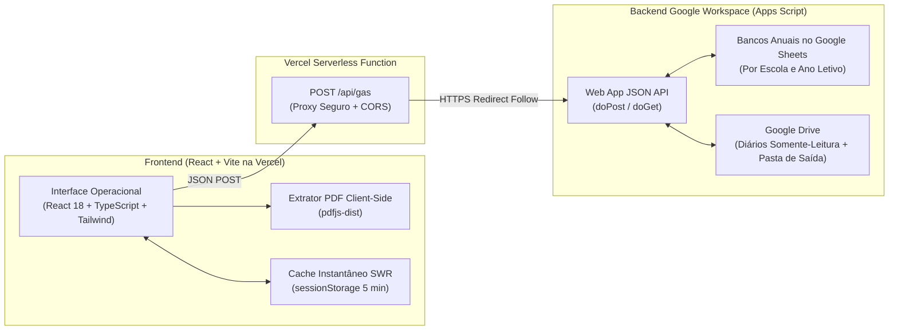

# SBF Panorama — Sistema de Conferência de Frequência Escolar do Bolsa Família

Aplicação web moderna em **React + TypeScript + Tailwind CSS** (hospedada na **Vercel**) integrada via Proxy Serverless (`/api/gas`) a um backend em **Google Apps Script + Google Sheets + Google Drive**, projetada para automatizar a conferência bimestral de frequência escolar dos estudantes beneficiários do Programa Bolsa Família.

---

## Visão Geral

O processo manual de conferência do Bolsa Família nas secretarias escolares exige abrir dezenas de diários de classe (`.xlsx` / Google Sheets), localizar cada estudante listado no formulário oficial (`.pdf`), verificar transferências ou remanejamentos, somar presenças e faltas dentro do intervalo de datas de cada mês do ciclo e justificar frequências abaixo do mínimo exigido (**60%** para Educação Infantil e **75%** para Ensino Fundamental).

O **SBF Panorama** transforma essa operação em um fluxo digital auditável, rápido e assistido:

1. **Conexão Direta à Pasta de Diários (Google Drive)**:
   - Aceita o link ou ID da pasta dos diários pelo Frontend e realiza a varredura recursiva das turmas, separando automaticamente **Educação Infantil (limite 60%)** e **Ensino Fundamental 1º ao 5º Ano (limite 75%)**.
2. **Pré-aquecimento do Índice de Alunos (`Indice Alunos Diarios`)**:
   - Indexa previamente os alunos das turmas em lotes, permitindo calcular a frequência apenas dos candidatos relevantes para o PDF enviado.
3. **Extração Instantânea do PDF no Navegador (`pdfjs-dist`)**:
   - Lê o PDF oficial do Bolsa Família diretamente no cliente em menos de 1 segundo, exibindo prévia imediata de `Nome`, `Data de Nascimento`, `NIS` e `Responsável Familiar` antes de iniciar a conferência.
4. **Mesa de Conferência por Ciclo Bimestral**:
   - **Fila de Pendências (Split-View)**: Revisão assistida lado a lado com busca por nome, série/turma ou número de chamada, navegação rápida por teclado (`↑` / `↓`) e avanço automático para o próximo aluno pendente.
   - **Tratamento de Alunos Transferidos e Movimentação Escolar**: Modal dedicado para registrar alunos transferidos para outra escola (sem diário), transferidos com frequência parcial no bimestre, remanejados internamente, evasão ou afastamento médico justificado.
   - **Memória Permanente de Vínculos por NIS**: Correções manuais e exceções confirmadas ficam associadas ao **NIS** do estudante, sendo reaproveitadas automaticamente nos ciclos seguintes.
   - **Fila de Lançamento no Portal MEC (`Abaixo do Limite`)**: Tabela operacional focada nos alunos com frequência inferior a 60%/75%, com cópia de NIS em 1 clique, edição inline de presenças/faltas (`P`/`F`), checklist de lançamento e modo de impressão A4.
5. **Gestão Multi-Escola, Multi-Ano e Virada de Ano (`Zerar Ciclos`)**:
   - Estrutura de pastas e bancos de dados isolados por **Escola** e por **Ano Letivo** (`📁 [Pasta Raiz] / 📁 [Nome da Escola] / 📁 [Ano Letivo]`).
   - Suporte completo para cadastrar ou alternar escolas, criar novos anos letivos (com migração opcional dos vínculos por NIS) e zerar os ciclos do ano com backup automático em `Historico_Arquivado`.

---

## Arquitetura do Projeto



---

## Tecnologias Utilizadas

- **Frontend**:
  - [React 18](https://react.dev/) + [TypeScript](https://www.typescriptlang.org/)
  - [Vite 6](https://vite.dev/)
  - [Tailwind CSS 4](https://tailwindcss.com/)
  - [Lucide Icons](https://lucide.dev/)
  - [PDF.js (`pdfjs-dist`)](https://mozilla.github.io/pdf.js/) para leitura instantânea de PDFs no navegador
- **Hospedagem & Serverless Proxy**:
  - [Vercel](https://vercel.com/) (`vercel.json` + Serverless Function em `api/gas.ts`)
- **Integração Backend**:
  - Google Apps Script (`ContentService` JSON API), Google Sheets e Google Drive

---

## Estrutura de Pastas (Frontend)

```text
├── api/
│   └── gas.ts                  # Serverless Function (Proxy para o Google Apps Script na Vercel)
├── web/
│   ├── api/
│   │   └── gas.ts              # Serverless Function (compatível quando Root Directory = web)
│   ├── src/
│   │   ├── services/
│   │   │   ├── gasApi.ts       # Cliente HTTP tipado para todas as actions da API
│   │   │   └── pdfExtractor.ts # Extrator client-side de PDFs do Bolsa Família e links do Drive
│   │   ├── types/
│   │   │   └── sbf.ts          # Tipagens TypeScript (Ciclos, Alunos, Movimentações, Escolas, Anos)
│   │   ├── App.tsx             # Aplicação principal (Painel, Diários, PDF, Mesa de Conferência, Configurações)
│   │   ├── main.tsx            # Ponto de entrada React
│   │   └── index.css           # Estilos globais e regras de impressão A4 (@media print)
│   ├── .env.example            # Modelo de variáveis de ambiente
│   ├── index.html              # Template HTML principal
│   ├── package.json            # Dependências e scripts do Frontend
│   ├── tsconfig.json           # Configuração TypeScript
│   ├── vercel.json             # Rewrites para SPA + API na Vercel
│   └── vite.config.ts          # Configuração do bundler Vite
├── .env.example                # Modelo de variáveis de ambiente na raiz
├── package.json                # Scripts unificados de build/dev na raiz
└── vercel.json                 # Configuração de build e rotas da Vercel na raiz
```

---

## Configuração de Variáveis de Ambiente (`.env`)

1. Copie o arquivo de exemplo `.env.example` para `.env` (na raiz e/ou em `web/.env`):

```bash
cp .env.example .env
cp web/.env.example web/.env
```

2. Preencha as variáveis com os dados do seu ambiente:

```env
# URL do Web App publicado no Google Apps Script (terminando em /exec)
GAS_WEBAPP_URL=
VITE_GAS_WEBAPP_URL=

# URL opcional da pasta raiz de dados gerados no Google Drive
VITE_PASTA_SAIDA_DADOS_URL=

# Chave secreta opcional (se configurada em PropertiesService -> GAS_API_SECRET no Apps Script)
GAS_API_SECRET=
```

> **Segurança**: Os arquivos `.env` e `web/.env` estão listados no `.gitignore` e nunca são enviados ao repositório Git.

---

## Como Executar Localmente

```bash
# 1. Instalar dependências do frontend
npm --prefix web install

# 2. Iniciar servidor de desenvolvimento (Vite)
npm --prefix web run dev

# 3. Gerar build de produção
npm --prefix web run build
```

---

## Como Hospedar na Vercel

O repositório já está pré-configurado para funcionar na Vercel tanto com **Root Directory = `./` (raiz)** quanto com **Root Directory = `web`**:

1. Acesse [vercel.com/new](https://vercel.com/new) e importe este repositório do GitHub.
2. Em **Environment Variables**, importe o seu arquivo `.env` local (ou adicione `GAS_WEBAPP_URL` e `VITE_GAS_WEBAPP_URL` apontando para a URL `/exec` do seu Web App no Google Apps Script).
3. Clique em **Deploy**.

---

## Privacidade e Proteção de Dados (LGPD)

Este repositório contém **exclusivamente o código-fonte do Frontend e do Proxy Serverless**. Nenhum dado pessoal de alunos (nomes, NIS, datas de nascimento), PDFs do Bolsa Família, planilhas de diários de classe ou credenciais privadas de acesso ao Google Drive fazem parte deste repositório.
