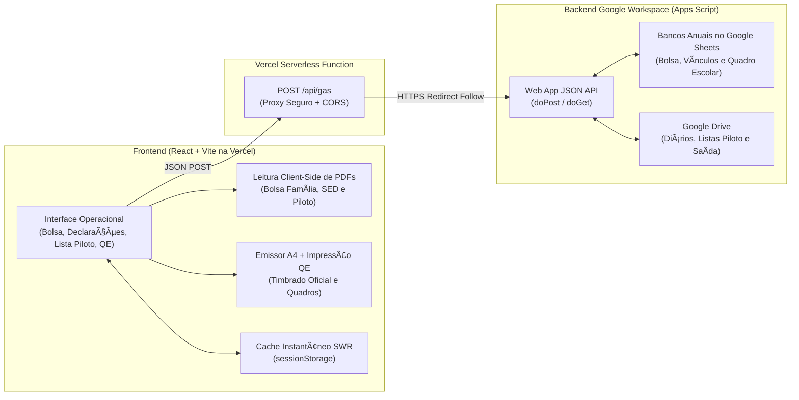

# SBF Panorama — Sistema de Gestão Escolar, Declarações, Lista Piloto, QE e Bolsa Família

Aplicação web moderna em **React + TypeScript + Tailwind CSS** (hospedada na **Vercel**) integrada via Proxy Serverless (`/api/gas`) a um backend em **Google Apps Script + Google Sheets + Google Drive**, desenvolvida para automatizar rotinas da secretaria escolar: conferência bimestral do Bolsa Família, emissão de declarações em papel timbrado, atualização das Listas Piloto (SED × Drive) e geração do **QE — Quadro Escolar**.

> **Guia para Funcionários (Sem Termos Técnicos):**  
> Consulte o tutorial completo de uso diário e configuração passo a passo em **[docs/MANUAL_DE_USABILIDADE_SISTEMA_ESCOLAR.md](../docs/MANUAL_DE_USABILIDADE_SISTEMA_ESCOLAR.md)** (dividido em **Parte 1 — Uso Diário** e **Parte 2 — Configurações e Virada de Ano**).

---

## Visão Geral dos Módulos

### 1. Bolsa Família (Conferência de Frequência)
- **Conexão Direta à Pasta de Diários (Google Drive)**: aceita o link ou ID da pasta dos diários pelo Frontend e realiza a varredura recursiva das turmas, separando automaticamente **Educação Infantil (limite 60%)** e **Ensino Fundamental (limite 75%)**.
- **Índice Acelerado de Alunos (`Indice Alunos Diarios`)**: indexa os alunos das turmas em lotes para acelerar o processamento dos ciclos bimestrais.
- **Extração Instantânea do PDF no Navegador (`pdfjs-dist`)**: lê o PDF oficial do Bolsa Família diretamente no cliente, exibindo prévia imediata de `Nome`, `Data de Nascimento`, `NIS` e `Responsável Familiar` antes de iniciar a varredura.
- **Mesa de Conferência por Ciclo Bimestral**:
  - **Fila de Pendências (Split-View)**: revisão assistida lado a lado com busca por nome, série/turma ou chamada, navegação por teclado (`↑` / `↓`) e avanço automático.
  - **Tratamento de Movimentação Escolar**: registro de transferências, transferência parcial, remanejamento interno, não pertencente à U.E., abandono ou afastamento justificado.
  - **Memória Permanente de Vínculos por NIS**: associações manuais e exceções confirmadas ficam vinculadas ao **NIS** e são reaproveitadas nos ciclos seguintes.
  - **Abaixo do Limite e Aprovação**: tabela operacional com cópia rápida de NIS, edição inline de presenças/faltas, checklist de lançamento, impressão A4 e geração de planilha oficial **Lista Aprovada** no Google Drive.

### 2. Declarações Escolares e com Faltas
Todas as declarações são geradas em folha **A4 com Papel Timbrado oficial** (com suporte a upload de papel timbrado personalizado e cabeçalho escolar editável):
- **Declaração de Matrícula**: preenche automaticamente nome, R.A., data de nascimento, ano/turma e horário padrão (**Manhã `07:00 às 11:40`** / **Tarde `13:00 às 17:40`**), sem exibir bloco de faltas.
- **Solicitação de Transferência**: modelo oficial com prazo de entrega do histórico/documentação (`40 dias`) e observação 100% editáveis.
- **Declaração de Conclusão (Individual ou em Lote)**: permite emitir para um aluno específico ou gerar **em lote todas as declarações dos alunos ativos de uma turma** selecionada diretamente das Listas Piloto.
- **Declaração de Frequência com Faltas (CRAS / Bolsa Família)**: calcula automaticamente dias letivos, comparecimentos e percentuais mês a mês (Fevereiro a Dezembro) direto dos diários, destaca meses abaixo do limite em amarelo e **preenche o número do R.A. automaticamente a partir das Listas Piloto** (mantendo edição manual livre).

### 3. Lista Piloto (Conferência SED × Google Drive & Ficha de Alunos)
- **Comparação Automática SED × Drive**: compara o relatório PDF **"Alunos por Classe"** da SED com as planilhas das Listas Piloto no Google Drive, identificando chegadas (`MS`), movimentações (`BXTR`, `TRAN`, `NCOM`, `REMA`, `CEDE`, `ABAN`) e preenchimento de R.A. ausente.
- **Direito de Imagem (`IM`) e Observações Acumulativas**: seleção rápida de `P+UE`, `P`, `UE`, `NÃO` ou em branco, além de marcadores acumulativos configuráveis para a coluna `OBS` (ex.: `@`, `TEG`, `TIO TIAGO`, `TIO ZEZINHO` e outras peruas escolares).
- **Sub-aba Procurar e Editar Aluno**: pesquisa unificada por nome, R.A., RM, NIS ou observação, com filtros por ano/série, sala específica, transporte/peruas e vínculo no Bolsa Família, permitindo edição direta na planilha do Google Drive e atalho para emitir declarações.
- **Turmas & Planilhas no Drive**: visualização individual por sala com totais de ativos, movimentados e acesso direto à planilha.

### 4. QE — Quadro Escolar
- **Adaptação Dinâmica Ano a Ano**: lê automaticamente os nomes das planilhas de Listas Piloto, a contagem de alunos ativos e os turnos (**MANHÃ** na linha superior e **TARDE** na linha inferior, com suporte a `AEE`).
- **Capacidades Editáveis Persistidas no Banco de Dados**: edição inline da capacidade de cada sala gravada diretamente na aba **`Quadro Escolar`** do Banco de Dados no Google Sheets.
- **Consolidação por Etapas e Resumo de Matrículas**: cálculo automático de `Cap. da Sala`, `Quant. Salas`, `Total de Alunos`, `Capacidade`, `Vagas`, `Período`, `Total Manhã`, `Total Tarde`, `Total sem AEE` e `Total Geral`.
- **Impressão em A4 Paisagem**: botão dedicado **Imprimir Quadro Escolar (QE)** abaixo dos quadros, gerando versão limpa para impressão ou PDF.

### 5. Gestão Multi-Escola, Multi-Ano e Vinculação Manual de Banco/Pastas
- Estrutura isolada por **Escola** e **Ano Letivo** no Google Drive (`[Pasta Raiz] / [Nome da Escola] / [Ano Letivo]`).
- Suporte para cadastrar/alternar escolas, abrir novos anos letivos, zerar ciclos com backup automático em `Historico_Arquivado`, e **vincular manualmente IDs/links de Banco de Dados, Pasta do Ano e Pasta da Escola** pela tela de Configurações (ideal para reaproveitar bancos existentes ou operar instâncias separadas por unidade escolar).

---

## Arquitetura do Projeto



---

## Tecnologias Utilizadas

- **Frontend**:
  - [React 18](https://react.dev/) + [TypeScript](https://www.typescriptlang.org/)
  - [Vite 6](https://vite.dev/)
  - [Tailwind CSS 4](https://tailwindcss.com/)
  - [Lucide Icons](https://lucide.dev/)
  - [PDF.js (`pdfjs-dist`)](https://mozilla.github.io/pdf.js/) para leitura client-side de PDFs do Bolsa Família e da SED
- **Hospedagem & Serverless Proxy**:
  - [Vercel](https://vercel.com/) (`vercel.json` + Serverless Function em `api/gas.ts`)
- **Integração Backend**:
  - Google Apps Script (`ContentService` JSON API), Google Sheets e Google Drive

---

## Estrutura de Pastas (Repositório GitHub)

```text
├── api/
│   └── gas.ts                                       # Serverless Function (Proxy para Google Apps Script na Vercel)
├── docs/
│   └── MANUAL_DE_USABILIDADE_SISTEMA_ESCOLAR.md   # Manual completo para funcionários (uso diário e configuração)
├── web/
│   ├── api/
│   │   └── gas.ts                                   # Serverless Function (compatível quando Root Directory = web)
│   ├── public/
│   │   └── timbrado-cotia.png                       # Cabeçalho timbrado oficial padrão (A4)
│   ├── src/
│   │   ├── components/
│   │   │   ├── DeclaracaoFaltasView.tsx             # Declaração com faltas (CRAS) e busca automática de RA
│   │   │   ├── DeclaracoesEscolaresView.tsx         # Matrícula, Solicitação de Transferência e Conclusão (Lote/Indiv.)
│   │   │   ├── ListaPilotoSedView.tsx               # Conferência SED × Listas Piloto, Ficha de Alunos e Peruas/OBS
│   │   │   ├── QuadroEscolarView.tsx                # QE - Quadro Escolar dinâmico, capacidades editáveis e impressão A4
│   │   │   └── RevisaoSplitView.tsx                 # Revisão assistida lado a lado da Mesa de Conferência
│   │   ├── services/
│   │   │   ├── configEscolarStore.ts                # Armazenamento local de timbrado, cabeçalho e marcadores OBS
│   │   │   ├── gasApi.ts                            # Cliente HTTP tipado para todas as actions da API
│   │   │   ├── pdfExtractor.ts                      # Extração client-side de PDFs do Bolsa Família e IDs do Drive
│   │   │   └── sedExtractor.ts                      # Extração de PDFs da SED e cruzamento com Listas Piloto
│   │   ├── types/
│   │   │   └── sbf.ts                               # Tipagens TypeScript (Ciclos, Alunos, Piloto, QE, Escolas)
│   │   ├── App.tsx                                  # Aplicação principal e roteamento dos 4 módulos
│   │   ├── main.tsx                                 # Ponto de entrada React
│   │   └── index.css                                # Estilos globais Tailwind e regras de impressão A4
│   ├── .env.example                                 # Modelo de variáveis de ambiente
│   ├── index.html                                   # Template HTML principal
│   ├── package.json                                 # Dependências e scripts do Frontend
│   ├── README.md                                    # Documentação espelhada quando Root Directory = web
│   ├── tsconfig.json                                # Configuração TypeScript
│   ├── vercel.json                                  # Rewrites para SPA + API na Vercel
│   └── vite.config.ts                               # Configuração do bundler Vite
├── .env.example                                     # Modelo de variáveis de ambiente na raiz
├── package.json                                     # Scripts unificados de build/dev na raiz
├── README.md                                        # Documentação principal do projeto
└── vercel.json                                      # Configuração de build e rotas da Vercel na raiz
```

---

## Configuração de Variáveis de Ambiente (`.env`)

1. Copie o arquivo de exemplo `.env.example` para `.env` (na raiz e/ou em `web/.env`):

```bash
cp .env.example .env
cp web/.env.example web/.env
```

2. Preencha as variáveis com os dados do seu ambiente:

```env
# URL do Web App publicado no Google Apps Script (terminando em /exec)
GAS_WEBAPP_URL=
VITE_GAS_WEBAPP_URL=

# URL opcional da pasta raiz de dados gerados no Google Drive
VITE_PASTA_SAIDA_DADOS_URL=

# Chave secreta opcional (se configurada em PropertiesService -> GAS_API_SECRET no Apps Script)
GAS_API_SECRET=
```

> **Segurança**: Os arquivos `.env` e `web/.env` estão listados no `.gitignore` e nunca são enviados ao repositório Git.

---

## Como Executar Localmente

```bash
# 1. Instalar dependências do frontend
npm --prefix web install

# 2. Iniciar servidor de desenvolvimento (Vite)
npm --prefix web run dev

# 3. Gerar build de produção
npm --prefix web run build
```

---

## Como Hospedar na Vercel

O repositório está pronto para publicação na Vercel (inclusive para múltiplas unidades escolares em projetos isolados):

1. Acesse [vercel.com/new](https://vercel.com/new) e importe o repositório do GitHub.
2. Em **Environment Variables**, adicione `GAS_WEBAPP_URL` e `VITE_GAS_WEBAPP_URL` apontando para a URL `/exec` da implantação do seu Google Apps Script.
3. Clique em **Deploy**.

---

## Privacidade e Proteção de Dados (LGPD)

Este repositório contém **exclusivamente o código-fonte do frontend e a documentação de uso**. Nenhum dado pessoal de alunos (nomes, NIS, RA, datas de nascimento), PDFs do Bolsa Família/SED, planilhas de diários de classe ou credenciais privadas de acesso ao Google Drive fazem parte deste repositório ou de seus arquivos de configuração.
